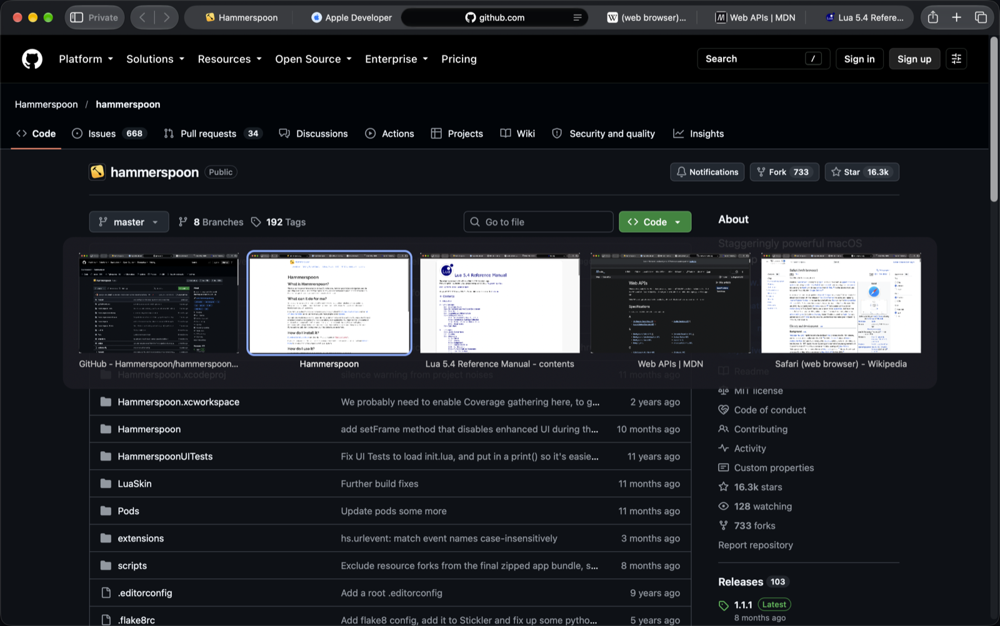
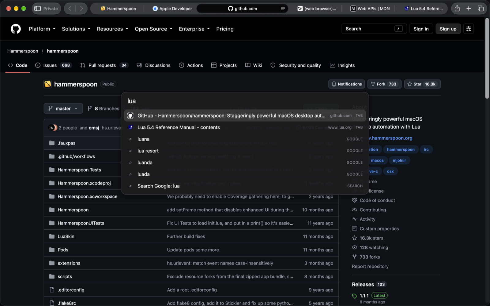
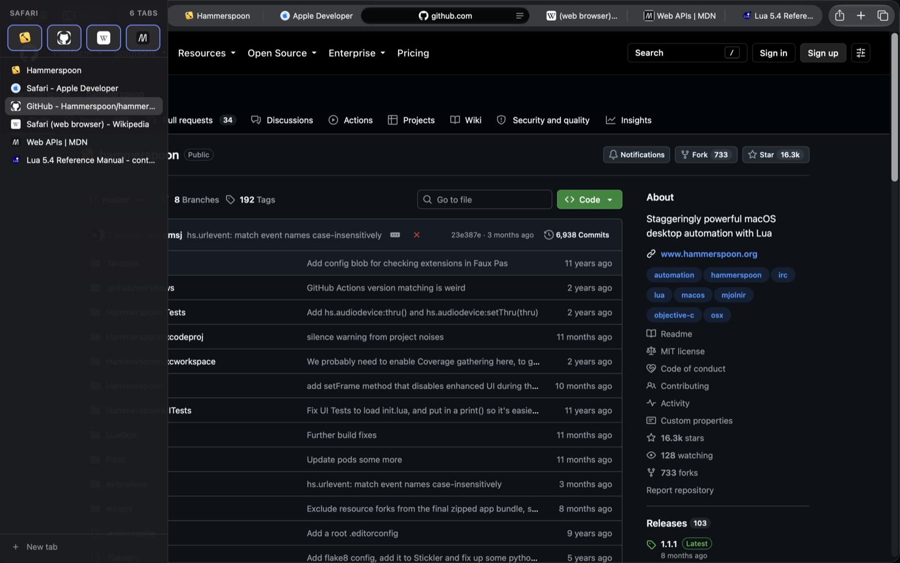

# safari-arc-kit

Arc browser habits for Safari, implemented as a set of [Hammerspoon](https://www.hammerspoon.org) modules.
No Safari extension, no Xcode, no mouse polling: a few hundred lines of Lua, two HTML panels, and AppleScript.

## What you get

| `⌃Tab` switcher | `⌘T` command bar | Hover sidebar |
|---|---|---|
|  |  |  |


| Feature | How it works |
|---|---|
| **`⌃Tab` switcher** | Cycles the 5 most-recently-used tabs of the current window, Arc style: tap for the previous tab, hold `⌃` for an overlay with page previews, `⇧` goes backwards, release `⌃` to switch, `Esc` cancels. Previews are window snapshots taken when you leave a tab. |
| **`⌃1` / `⌃2` profiles** | Raises the Safari window of a given profile (Personal, Work, …), creating it via *File → New … Window* if needed. Only active while Safari is frontmost. |
| **`⌘T` command bar** | Spotlight-like panel over the Safari window: searches open tabs (Enter switches), shows Google suggestions, opens URLs, and supports prefix modes such as `gh <query>` or `jira <JQL>`. Type just the prefix and press Enter to lock the mode. |
| **Hover sidebar** | Move the mouse to the left edge of the Safari window and a vertical tab list slides over the page content: favorites grid, tabs with favicons, close buttons, new tab. Leaves when the mouse does. Page content never shifts. Detection uses a 6 px invisible edge window, so there is no mouse tracking while idle. |
| **Auto-close tabs** | Closes tabs whose URL matches a pattern as soon as they become active, e.g. local OAuth callbacks (`127.0.0.1:<port>/oauth/callback?code=…`) that CLIs open and Safari will not let a userscript close. |

## Install

1. Install Hammerspoon and grant it **Accessibility** and **Screen Recording** (the latter only for `⌃Tab` previews):
   ```
   brew install --cask hammerspoon
   ```
2. Clone into your Hammerspoon directory:
   ```
   git clone https://github.com/ikvict07/safari-arc-kit ~/.hammerspoon/safari-arc-kit
   ```
3. Add to `~/.hammerspoon/init.lua`:
   ```lua
   safari_arc_kit = require("safari-arc-kit")
   ```
4. Optional but recommended: copy `config.example.lua` to `~/.hammerspoon/safari-arc-kit-config.lua` and set your profiles, favorites, command modes and auto-close rules.
5. Reload Hammerspoon.

Safari profiles are detected from window titles (`Work — Page title`), so create them in *Safari → Settings → Profiles* first.

## Configuration

Everything personal lives in `~/.hammerspoon/safari-arc-kit-config.lua`; see `config.example.lua` for all keys. Defaults are in `hammerspoon/kit_config.lua`.

- `profiles`: `{key, name}` pairs for `⌃<key>`.
- `favorites[profileName]`: `{title, url}` icons at the top of the sidebar. Clicking switches to an open tab of that site or opens it.
- `modes`: `⌘T` prefixes, `%s` is replaced with the percent-encoded query.
- `autoclose`: Lua patterns matched against tab URLs, with a delay in seconds.
- `tabs`, `sidebar`, `command`: sizes and timings.

Styling of the panels is plain CSS in `hammerspoon/command_bar.html` and `hammerspoon/sidebar.html` (`:root` variables, light and dark).

## Limitations

- Safari exposes tabs to AppleScript without stable ids, so tabs are keyed by URL + title; two identical tabs collapse into one entry.
- The sidebar cannot reorder tabs or manage Tab Groups and pinned tabs: AppleScript has no API for them.
- Previews in `⌃Tab` are snapshots of the whole window, taken only for tabs you have visited.
- Google suggestions send what you type to Google, like any browser address bar. They are off inside prefix modes.

## Development

```
lua test/mru_test.lua
lua test/command_parse_test.lua
```

Reload Hammerspoon after changes. `hs.reload()` from a timer has crashed Hammerspoon; quitting and reopening it is reliable.

## License

MIT
